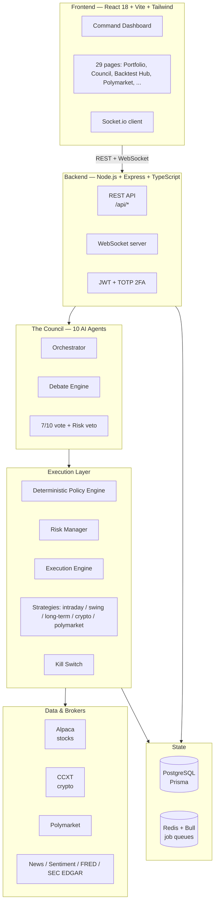

<div align="center">


<br/><br/>


# BHISHMA

### The Autonomous Multi-Agent AI Trading Platform

*Named for Bhishma of the Mahabharata — the grandsire who kept his oath above all else.
Bhishma takes one oath: **preserve the capital.***

[](https://github.com/IamTharunsai/tharun-trading-/actions/workflows/ci.yml)
[](LICENSE)
[](backend/package.json)
[](backend/tsconfig.json)
[](CONTRIBUTING.md)

[Quick Start](#-quick-start) •
[The Council](#-the-10-agent-council) •
[Architecture](#%EF%B8%8F-architecture) •
[Dashboard](#-dashboard) •
[API](#-api-reference) •
[Guardrails](#%EF%B8%8F-guardrails)

</div>

---

## What is Bhishma?

Bhishma is a fully autonomous trading system. Ten specialized AI agents debate every
trade — technicals, news, sentiment, fundamentals, macro, on-chain flows — and vote.
**7 of 10 votes are required to execute, and the Risk Manager holds an absolute veto.**
A deterministic policy engine, hard guardrails, and a one-tap kill switch sit above
it all, so the oath — *preserve the capital* — is enforced in code, not hoped for.

| | |
|---|---|
| 🤖 **10-agent council** | Every position is debated and voted on — no single-model trades |
| 🛡️ **Military-grade guardrails** | Daily loss limits, drawdown halts, kill switch, 30% cash reserve |
| 📊 **Stocks + crypto + prediction markets** | Alpaca (equities), CCXT (crypto), Polymarket — one command surface |
| 🔬 **Backtest everything** | Strategy lab with historical replay before a rupee/dollar goes live |
| 📓 **Full audit trail** | Every decision, vote, fill, and override is logged and inspectable |
| ⚡ **Real-time** | WebSocket-driven dashboard, live market streams, instant alerts |

> ⚠️ **Paper trade first.** Bhishma ships in paper mode. Live trading is a deliberate,
> checklist-gated decision — see [Paper Trading First](#-paper-trading-first).

---

## 🏛️ Architecture



---
## 🤖 The 10-Agent Council

No trade happens on one model's opinion. Every opportunity goes through a structured
debate — opening case, challenge round, Devil's Advocate rebuttal — then a vote.

| # | Agent | Role | Veto? |
|---|-------|------|-------|
| 1 | The Technician | RSI, MACD, Bollinger, EMA, candlestick patterns | No |
| 2 | The Newshound | Breaking news, earnings, regulatory events | No |
| 3 | The Sentiment Analyst | Fear & Greed, social mood, options sentiment | No |
| 4 | The Fundamental Analyst | P/E, revenue, market cap, tokenomics | No |
| 5 | **The Risk Manager** | Capital preservation, portfolio risk | **YES — absolute veto** |
| 6 | The Trend Prophet | AI price prediction, trend analysis | No |
| 7 | The Volume Detective | OBV, volume spikes, accumulation/distribution | No |
| 8 | The Whale Watcher | Institutional flows, on-chain activity | No |
| 9 | The Macro Economist | Fed policy, rates, global risk sentiment | No |
| 10 | The Devil's Advocate | Argues **against** every trade — finds the flaws | Soft block |

**7/10 votes required to execute. The Risk Manager can veto anything.**

---

## 🛡️ Guardrails

The oath, enforced in code:

| Rule | Default | Action |
|------|---------|--------|
| Daily Loss Limit | 5% | Halt trading for the day |
| Weekly Drawdown | 10% | Pause — manual override required |
| Max Drawdown | 20% | EMERGENCY STOP + kill switch |
| Cash Reserve | 30% | Never deploy more than 70% |
| Max Risk / Trade | 1% | Hard position-size cap |
| Max Trades / Day | 50 | Prevents runaway loops |
| Stop Loss (Crypto) | 3% | Auto-placed on every trade |
| Stop Loss (Stocks) | 2% | Auto-placed on every trade |

---

## 🚀 Quick Start

### Prerequisites

- **Node.js v20+** (`node --version`)
- **Docker Desktop** running (for PostgreSQL + Redis)
- API keys: Alpaca (paper), Anthropic — see `.env.example` for the full list

### 1. Clone

```bash
git clone https://github.com/IamTharunsai/tharun-trading-.git
cd tharun-trading-
```

### 2. Start infrastructure

```bash
docker compose up -d        # PostgreSQL + Redis
```

### 3. Configure the backend

```bash
cd backend
cp ../.env.example .env     # then fill in your API keys
npm install
npx prisma generate
npx prisma migrate dev
```

### 4. Create your owner account

```bash
npm run dev
```

In another terminal:

```bash
curl -X POST http://localhost:4000/api/auth/setup-owner \
  -H "Content-Type: application/json" \
  -d '{"email":"you@example.com","password":"YourSecurePassword123!"}'
# Password minimum: 12 characters. Response returns your login token.
```

> In production, pass the setup token via the `x-setup-token` header instead.

### 5. Start the frontend

```bash
cd ../frontend
npm install
npm run dev                 # open http://localhost:3000
```

### 6. Log in

Open http://localhost:3000 → email + password → 6-digit TOTP code.

---
## 📱 Dashboard

The command surface — 29 pages across four spaces: **Command**, **Strategy**,
**Council**, **Chronicle**.

| Page | Path | What it shows |
|------|------|---------------|
| Dashboard | `/` | Real-time P&L, exposure, agent council, risk monitor |
| Portfolio | `/portfolio` | Holdings, allocation, value history |
| Trades | `/trades` | Full trade table with stats |
| Agent Council | `/agents` | Live 10-agent panel + decision history |
| Agent Chat | `/agents/chat` | Talk to the council |
| Debate Room | `/agents/debate-room` | Watch a live trade debate |
| Agent Monitor | `/agents/monitor` | Agent health, latency, activity |
| Charts | `/charts` | Candlestick charts, real market data |
| Analytics | `/analytics` | Win rate, P&L curves, performance |
| Journal | `/journal` | AI-generated daily entries |
| News | `/news` | Analyzed market news with sentiment |
| Market Recap | `/recap` | Daily market debrief |
| Live TV | `/live-tv` | Streaming market coverage |
| Stock Universe | `/stocks` | Screener universe management |
| Screener | `/screener` | Custom stock screens |
| Tearsheet | `/tearsheet` | Position deep-dives |
| Options Chain | `/options` | Options flow + chains |
| Macro Dashboard | `/macro` | Fed, rates, regime, intermarket |
| Insider Transactions | `/insider` | Insider buying/selling signals |
| Crypto Strategy | `/crypto-strategy` | Crypto engine control |
| Price Forecaster | `/forecaster` | AI price predictions |
| Multi-Agent Research | `/multi-agent` | Research runs across agents |
| Alternative Data | `/alternative-data` | Alt-data signals |
| Polymarket | `/polymarket` | Prediction-market edge |
| Copy Trading | `/copy-trading` | Copy-trading engine |
| Investment | `/investment` | Long-term investment view |
| Backtest Hub | `/backtest` | Strategy lab + historical replay |
| Quote | `/quote` | Quick quote panel |
| Settings | `/settings` | Guardrails, keys, preferences |

---

## 🔌 API Reference

Base URL: `http://localhost:4000`

| Area | Prefix | Highlights |
|------|--------|------------|
| Auth | `/api/auth` | `POST /login`, `POST /setup` (email + password + TOTP) |
| Portfolio | `/api/portfolio` | `GET /`, `/positions`, `/snapshots` |
| Trades | `/api/trades` | `GET /`, `/stats` |
| Agents | `/api/agents` | `GET /decisions` — council voting history |
| Agent Monitor | `/api/monitor` | Agent health + activity |
| Market | `/api/market` | `GET /prices`, `/news` |
| Intelligence | `/api/intelligence` | Research + signal endpoints |
| Backtest | `/api/backtest` | Run + inspect backtests |
| Copy Trading | `/api/copy-trading` | Engine control |
| Polymarket | `/api/polymarket/greed` | Prediction-market endpoints |
| Journal | `/api/journal` | Daily AI entries |
| Chat | `/api/chat` | Talk to the council |
| Settings | `/api/settings` | Guardrail configuration |
| Kill Switch | `/api/kill-switch` | `POST /activate`, `POST /deactivate`, `GET /status` |
| System | `/api/system` | `GET /health` and system state |

Full route inventory (115 endpoints): [`docs/api.md`](docs/api.md)

---

## 🏗️ Project Structure

```
tharun-trading-/
├── assets/                  # Logo, banner, brand assets
├── backend/                 # Node.js + Express + TypeScript
│   └── src/
│       ├── agents/          # 10-agent council: orchestrator, debate engine, voting
│       ├── trading/         # Execution engine, risk manager, strategies, kill switch
│       ├── services/        # Market data, brokers (Alpaca/CCXT), intelligence
│       ├── routes/          # REST API
│       ├── websocket/       # Socket.io real-time server
│       ├── jobs/            # Bull queue scheduler
│       ├── middleware/      # Auth (JWT + TOTP)
│       └── utils/           # Logger, Prisma, Redis singletons
├── frontend/                # React 18 + Vite + Tailwind + Zustand
│   └── src/
│       ├── pages/           # 29 dashboard pages
│       ├── components/      # Council panels, charts, risk monitors
│       ├── store/           # Global state
│       └── services/        # API + WebSocket clients
├── e2e/                     # Playwright end-to-end tests
├── .github/workflows/       # CI + deploy pipelines
├── docker-compose.yml       # PostgreSQL + Redis
└── .env.example             # All configuration keys (never commit .env)
```

---
## 🌐 Deployment

**Backend → Railway**

```bash
npm install -g @railway/cli
railway login
railway up
# Set every variable from .env.example in the Railway dashboard
```

**Frontend → Vercel**

```bash
npm install -g vercel
cd frontend
vercel --prod
```

---

## ⚠️ Paper Trading First

Bhishma starts in paper mode, and it should stay there until it earns live capital.

**Never go live until:**

- [ ] Paper traded 2+ weeks with positive P&L
- [ ] All guardrails tested and confirmed
- [ ] Kill switch tested — halts within 1 second
- [ ] Daily loss limit tested — halts when hit
- [ ] 2FA working on your account
- [ ] Broker API keys are **trade-only** — no withdrawal permissions, ever

To switch to live:

```env
TRADING_MODE=live
ALPACA_BASE_URL=https://api.alpaca.markets
```

---

## 🗺️ Roadmap

- [ ] Live broker reconciliation dashboard
- [ ] Strategy marketplace (share / import council strategies)
- [ ] Mobile companion app
- [ ] Multi-owner / team mode
- [ ] Options auto-hedging engine

---

## 🤝 Contributing

PRs are welcome. For major changes, open an issue first to discuss what you'd like to change.
Please paper-trade any strategy change for 2 weeks before proposing it for the default config.

## 📄 License

MIT — see [LICENSE](LICENSE).

---

<div align="center">


**BHISHMA** — *The oath is preserve the capital.*

Built by [Tharun Sai Nandigam](https://github.com/IamTharunsai)

</div>
